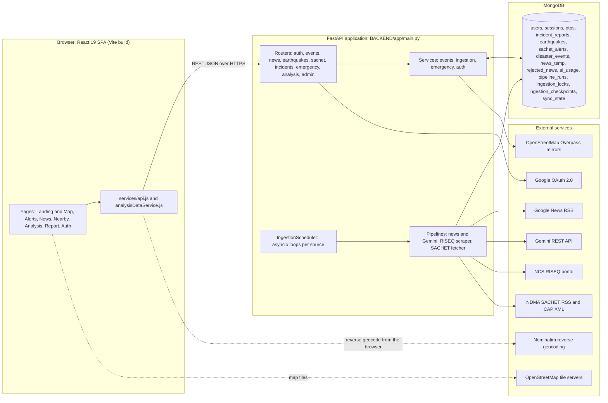
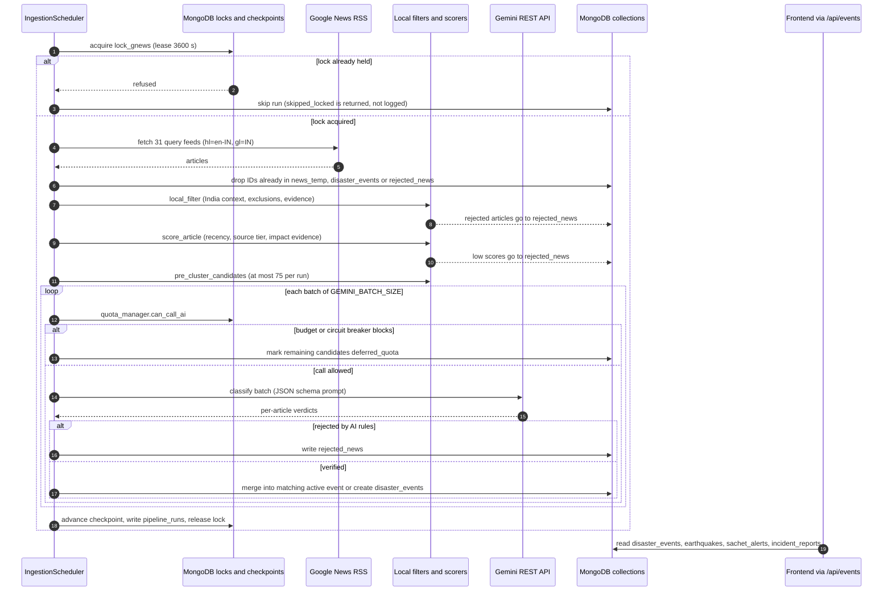

# DISHA — Disaster Intelligence and Situational Hazard Awareness Platform

DISHA is a full-stack web application that collects disaster and emergency information for India from several sources, normalizes it into one event model, and shows it on an interactive map and in analytics views. The sources are the National Center for Seismology (earthquakes), NDMA SACHET (official CAP alerts), news headlines classified by Google's Gemini API, and reports submitted by signed-in citizens.

> **Status: academic / hackathon-grade project.** It is not an official source of emergency information. For decisions that affect safety, use NDMA, IMD, NCS and your local authorities. See [Disclaimer](#disclaimer) and [Known Limitations](#known-limitations).

---

## Table of Contents

1. [Overview](#overview)
2. [Problem Statement and Objectives](#problem-statement-and-objectives)
3. [Features and Implementation Status](#features-and-implementation-status)
4. [System Architecture](#system-architecture)
5. [Technology Stack](#technology-stack)
6. [Data Sources and External Integrations](#data-sources-and-external-integrations)
7. [AI and Heuristic Methodology](#ai-and-heuristic-methodology)
8. [Complete Data Flow](#complete-data-flow)
9. [Project Directory Structure](#project-directory-structure)
10. [Installation and Local Development](#installation-and-local-development)
11. [Configuration Reference](#configuration-reference)
12. [API Reference](#api-reference)
13. [Database Architecture](#database-architecture)
14. [Deployment](#deployment)
15. [Screenshots and Demo](#screenshots-and-demo)
16. [Testing](#testing)
17. [Known Limitations](#known-limitations)
18. [Future Scope](#future-scope)
19. [Team and Contributors](#team-and-contributors)
20. [License](#license)
21. [Disclaimer](#disclaimer)

---

## Overview

The repository is a monorepo with two deployable parts:

| Part | Path | Role |
|---|---|---|
| Backend | [`BACKEND/`](./BACKEND) | FastAPI service: ingestion pipelines, scheduler, REST API, authentication, MongoDB access |
| Frontend | [`FRONTEND/`](./FRONTEND) | React single-page application: live map, alerts, news, analytics, incident reporting |

Production URLs referenced in the code are `https://disha-platform.vercel.app` (frontend, set as a default CORS origin and OAuth redirect target) and `https://disha-platform.onrender.com` (backend, used as the production fallback API URL). The repository cannot confirm that these deployments are currently live.

## Problem Statement and Objectives

Disaster information in India is spread across government feeds, seismology portals and news coverage, in inconsistent formats and with uneven location data. DISHA's code addresses this with the following objectives, each of which maps to implemented functionality:

- **Aggregate** earthquakes, official alerts, verified news incidents and citizen reports in one event feed (`/api/events`).
- **Filter noise** from news (sports, metaphors, forecasts without impact, foreign events, old incidents) before and after AI classification.
- **Avoid silently dropping events**: events without coordinates are kept and counted as "unmapped" (`T = M + U` invariant, covered by `tests/test_data_consistency.py`).
- **Help locate help**: look up nearby hospitals, police and fire stations for an event, with directions links.
- **Let citizens report** incidents with location and photos (requires sign-in).

## Features and Implementation Status

Status key: **Implemented** = reachable end-to-end in code; **Partial** = present but with a significant gap; **Scaffolded** = code exists but nothing in the application reaches it.

| Feature | Status | How it works | Main code |
|---|---|---|---|
| Unified event feed | Implemented | Merges four MongoDB collections into one normalized list with time-range, category, severity, source and location filters | [`events_service.py`](./BACKEND/app/services/events_service.py), [`routes/events.py`](./BACKEND/app/routes/events.py) |
| Live map | Implemented | Leaflet map with OpenStreetMap tiles, category markers, time-range filter, and an "unmapped events" accounting | [`LiveDisasterMap.jsx`](./FRONTEND/src/pages/LandingPage/components/LiveDisasterMap.jsx) |
| Earthquake ingestion | Implemented | Scrapes the HTML table of the NCS RISEQ portal, converts times to UTC, classifies India relevance, upserts by deterministic ID | [`sources/riseq.py`](./BACKEND/app/sources/riseq.py), [`earthquake_service.py`](./BACKEND/app/services/earthquake_service.py) |
| NDMA SACHET alerts | Implemented | Fetches the SACHET RSS feed with ETag / Last-Modified caching, then fetches each CAP XML alert concurrently, extracts polygons and centroids | [`sources/sachet.py`](./BACKEND/app/sources/sachet.py), [`sachet_service.py`](./BACKEND/app/services/sachet_service.py) |
| AI-assisted news verification | Implemented | Google News RSS → local filters and scoring → clustering → batched Gemini classification → event creation or merge | [`fetch_gnews.py`](./BACKEND/app/services/fetch_gnews.py), [`gemini_controller.py`](./BACKEND/app/services/gemini_controller.py) |
| Event deduplication | Implemented | Title-token Jaccard similarity and location rules before AI; stable event IDs and active-event matching after AI | [`event_clustering.py`](./BACKEND/app/services/event_clustering.py) |
| Background scheduling | Implemented | In-process asyncio loops per source, MongoDB distributed locks, checkpoints, run logs, retry with backoff | [`ingestion_scheduler.py`](./BACKEND/app/services/ingestion_scheduler.py) |
| Gemini quota protection | Implemented | Daily request/token budget, per-minute throttle, reserve margin, 429 circuit breaker, fingerprint cache, deferral queue | [`gemini_quota_manager.py`](./BACKEND/app/services/gemini_quota_manager.py) |
| Emergency service discovery | Implemented | Overpass API query around an event, Haversine ranking, mirror fallback, 1-hour in-memory cache, auto-expanding radius | [`emergency_service.py`](./BACKEND/app/services/emergency_service.py) |
| Directions | Implemented | Client-side URL builder (Apple Maps on iOS, Google Maps otherwise) | [`navigation.js`](./FRONTEND/src/utils/navigation.js) |
| Google OAuth sign-in | Implemented | Authlib flow with direct-HTTP fallback, JWT access token, refresh-token rotation, server-side sessions | [`routes/auth.py`](./BACKEND/app/routes/auth.py), [`auth_service.py`](./BACKEND/app/services/auth_service.py) |
| Citizen incident reporting | Partial | Authenticated submit/list; shown in the unified feed. No moderation or verification workflow, photos stored as base64 in MongoDB, and a likely defect in feed merging (see [Known Limitations](#known-limitations)) | [`routes/incidents.py`](./BACKEND/app/routes/incidents.py), [`ReportIncidentPage.jsx`](./FRONTEND/src/pages/ReportIncidentPage.jsx) |
| Analytics dashboard | Implemented | Frontend aggregates `/api/events`, `/api/analysis/overview`, `/api/news/rejected` and `/api/news/stats` into KPIs and charts drawn by a custom chart component | [`AnalysisPage/`](./FRONTEND/src/pages/AnalysisPage), [`analysisDataService.js`](./FRONTEND/src/services/analysisDataService.js) |
| News list and detail pages | Implemented | Lists verified news events and shows detail with sources and evidence | [`RecentNewsPage.jsx`](./FRONTEND/src/pages/RecentNewsPage.jsx), [`NewsDetailPage.jsx`](./FRONTEND/src/pages/NewsDetailPage.jsx) |
| Alerts page | Implemented | Map and list view of verified disaster events with filters | [`AlertsPage.jsx`](./FRONTEND/src/pages/AlertsPage.jsx) |
| Admin ingestion API | Implemented | Status, quota, run history, manual trigger, lock release; guarded by `X-Admin-Key` or an admin user | [`routes/admin_ingestion.py`](./BACKEND/app/routes/admin_ingestion.py) |
| Email / password login, OTP | Scaffolded | Models, hashing, OTP service and Brevo/SMTP email service exist; no route or service imports the OTP or email code | `core/security.py`, `services/otp_service.py`, `services/email_service.py` |
| Fullscreen map page | Scaffolded | `ViewMapPage` renders a placeholder ("Empty Page Container for Future Implementation") | [`ViewMapPage.jsx`](./FRONTEND/src/pages/ViewMapPage.jsx) |
| "Other feeds" ingestion | Scaffolded | The scheduler job only advances a checkpoint; it fetches nothing | `run_other_feeds_ingestion` |
| Citizen report reconcile job | Scaffolded | The hourly job counts documents and advances a checkpoint; it does not validate or modify reports | `run_citizen_reports_reconcile` |
| Real-time push (WebSocket / SSE) | Not present | The frontend fetches on load and on filter changes; no polling timer or push channel was found | — |

## System Architecture

### Component diagram



### Sequence diagram: news ingestion and verification



### Architecture explanation

- **Layering (backend).** `routes/` handle HTTP and validation, `services/` hold business logic and pipelines, `sources/` contain the raw scrapers for RISEQ and SACHET, `repositories/` wrap MongoDB access for users, sessions, OTPs and incident reports.
- **Two MongoDB drivers.** Authentication and incident reporting use the async `motor` driver ([`core/database.py`](./BACKEND/app/core/database.py)). Ingestion, events, news and analysis use the synchronous `pymongo` client ([`database/mongodb.py`](./BACKEND/app/database/mongodb.py)), which is created at import time and requires `MONGO_URI`. Synchronous pipelines are run in the default thread-pool executor by the scheduler.
- **Scheduler.** On application startup, `IngestionScheduler.start()` creates one asyncio loop per source (GNews 6 h; earthquakes, SACHET, "other feeds" and citizen reconcile 1 h by default). Each loop waits a randomized 5–20 s stagger, runs the job in an executor, then sleeps. Each job takes a MongoDB lease lock so multiple replicas do not overlap, retries with exponential backoff and jitter, advances a per-source checkpoint only on success, and writes a `pipeline_runs` record.
- **Frontend.** There is no client-side router. `App.jsx` switches pages with a `currentPage` state value, and keeps the landing page mounted so Leaflet state survives navigation. Only `/auth/google/success` is interpreted from the URL. `vercel.json` rewrites all paths to `index.html`.
- **Frontend fallback.** If `/api/events` fails, `fetchEvents` falls back to calling `/api/earthquakes`, `/api/sachet` and `/api/news/disasters` separately. That fallback does not include citizen reports.

## Technology Stack

### Backend (`BACKEND/`)

| Area | Technology (from `BACKEND/requirements.txt`) |
|---|---|
| Language / runtime | Python 3.11 (`.python-version`; `pyproject.toml` requires `>=3.11`) |
| Web framework | FastAPI, Starlette, Uvicorn, Pydantic v2, pydantic-settings |
| Database drivers | `motor` (async), `pymongo[srv]` (sync) |
| Authentication | PyJWT (HS256), Authlib (Google OAuth), `argon2-cffi` / `bcrypt` (password hashing, unused by any route), `itsdangerous`, Starlette `SessionMiddleware` |
| Ingestion | `requests`, `beautifulsoup4`, `feedparser`, stdlib `xml.etree` |
| AI | Gemini `generateContent` REST endpoint, called directly with `requests` |
| HTTP client (OAuth fallback) | `httpx` |
| Testing | `pytest`, `pytest-asyncio`, `httpx` |

### Frontend (`FRONTEND/`)

| Area | Technology (from `FRONTEND/package.json`) |
|---|---|
| Framework / build | React ^19.0.1, Vite ^6.2.3, `@vitejs/plugin-react` |
| Styling | Tailwind CSS 4 (`@tailwindcss/vite`) |
| Maps | Leaflet ^1.9.4 (core library, used imperatively) |
| UI | `lucide-react`, `framer-motion` |
| Charts | Custom component [`DISHALightweightCharts.jsx`](./FRONTEND/src/components/charts/DISHALightweightCharts.jsx) (no charting library) |
| Language | JavaScript (`.jsx`); `tsconfig.json` is present with `allowJs` |

### Declared but unused dependencies

Static search found no import of these packages in application code:

- Backend: `geopandas`, `shapely`, `pyproj`, `folium`, `google-genai`, `google-auth`, `python-dateutil`, `pytz`. Geospatial work (Haversine distance, centroid lookup, polygon centroid) is hand-written. `lxml`, `email-validator` and `python-multipart` are not imported directly but may be pulled in implicitly by other libraries.
- Frontend: `react-leaflet`, `@google/genai`, `express`, `dotenv`, `motion`, `tsx`.

## Data Sources and External Integrations

| Source | Used for | Access method | Notes |
|---|---|---|---|
| NCS RISEQ (`riseq.seismo.gov.in`) | Earthquakes | HTML scraping with BeautifulSoup | 30-day rolling window; India relevance classes `INDIA`, `INDIA_BORDER`, `REGIONAL`, `OTHER`; SSL verification **off by default** (`RISEQ_VERIFY_SSL`) |
| NDMA SACHET (`sachet.ndma.gov.in`) | Official CAP alerts | RSS feed + one CAP XML request per alert | ETag / Last-Modified conditional requests; SSL verification **off by default** (`SACHET_VERIFY_SSL`); polygon centroid used for coordinates |
| Google News RSS | News candidates | `feedparser` over `news.google.com/rss/search` | 31 hard-coded query strings in `NEWS_QUERIES`, India edition |
| Gemini API | Classification of news candidates | REST `generateContent` | Model from `GEMINI_MODEL`, with an in-code fallback list; temperature 0.1, JSON response mode |
| OpenStreetMap Overpass | Hospitals, police, fire stations | Overpass QL over four public mirrors | In-memory 1-hour cache; coverage depends on OSM data |
| Google OAuth 2.0 | Sign-in | Authlib / direct HTTPS | Scopes `openid email profile` |
| Nominatim | Address text for a captured GPS position | Called **from the browser** in `ReportIncidentPage` | Not called by the backend |
| OpenStreetMap tiles | Base map | Browser tile requests | Attribution is included in the map code |
| Brevo / SMTP | Email (OTP) | HTTPS API / SMTP | Code exists but is unreachable from any route |
| Survey of India boundary | Map boundary overlay | Bundled GeoJSON in `FRONTEND/src/data/indiaBoundaryGeojson.js` | Static data |

## AI and Heuristic Methodology

DISHA contains **no trained or self-hosted machine-learning models**. "AI" means one remote LLM call per batch of news candidates. Everything else is deterministic rule-based code.

### Stage 1 — deterministic pre-processing (no AI)

1. **Normalize and deduplicate** RSS entries by canonical URL and content hash; skip IDs already stored.
2. **Local filter** ([`fetch_gnews.py`](./BACKEND/app/services/fetch_gnews.py)): reject excluded headlines (sports, metaphors, and so on), require India context via offline place detection, and require disaster keywords or ground-impact / emergency-response evidence from [`evidence_detector.py`](./BACKEND/app/services/evidence_detector.py).
3. **Quality and recency scoring** ([`quality_scorer.py`](./BACKEND/app/services/quality_scorer.py), [`temporal_extractor.py`](./BACKEND/app/services/temporal_extractor.py), [`source_scorer.py`](./BACKEND/app/services/source_scorer.py)): extract the incident date from text, reject old or anniversary stories and forecast-only items, weight by publisher tier, and compute a priority score. Thresholds are environment-configurable (defaults include a 72-hour maximum age and a minimum candidate score of 5.0).
4. **Pre-clustering** ([`event_clustering.py`](./BACKEND/app/services/event_clustering.py)): group likely duplicates using disaster-type overlap, extracted locations and Jaccard title similarity (thresholds around 0.35–0.45), without merging different districts. At most 75 candidates (`MAX_GEMINI_CANDIDATES`) go to the AI stage.

### Stage 2 — LLM classification (Gemini)

- A system prompt instructs the model to act as a disaster classifier and return strict JSON with `is_disaster`, `is_current`, `is_historical`, `is_forecast_only`, `is_india`, `confidence`, `disaster_type`, `severity`, location fields, `incident_date`, a one-sentence `reason` and `evidence` bullets.
- Articles are sent in batches (`GEMINI_BATCH_SIZE`, default 10). Responses are validated and missing IDs are retried selectively.
- **Acceptance rule in code:** an article is rejected if it is not a disaster, not in India, historical, forecast-only, not current, or below `GEMINI_CONFIDENCE_THRESHOLD` (default 0.70). Accepted articles get tier `high` at or above `GEMINI_AUTO_VERIFY_THRESHOLD` (default 0.90) and `medium` otherwise.
- **Model fallback:** retries move through a list of model names defined in `gemini_controller.py`. Whether those model names exist for your API key is not verified by the repository.
- **Quota safety:** budgets, RPM limit, reserve margin, circuit breaker (15-minute cooldown after HTTP 429), fingerprint cache, and `deferred_quota` / `pending_ai` / `failed` article states so candidates survive quota exhaustion.

### Stage 3 — event creation and merge

Verified articles are matched to an existing active event by type, location and date (`find_matching_active_event`). A match adds the article as corroboration (source count, evidence, max confidence); otherwise a new `disaster_events` document is created with a stable event ID and an offline geocode.

### Geocoding

Geocoding is an offline registry lookup ([`geocoding.py`](./BACKEND/app/services/geocoding.py), [`geo_filter_service.py`](./BACKEND/app/services/geo_filter_service.py)): district or city centroid, then state centroid, otherwise `unresolved` with no coordinates. These are **centroids, not precise incident locations**. The code deliberately refuses to assign a default India centroid to unresolved events.

### What is not AI

Earthquake and SACHET ingestion contain no AI. Citizen reports are not classified or verified by any model.

## Complete Data Flow

1. **Trigger.** The scheduler loops (or an admin call to `POST /api/admin/ingestion/trigger`, or the unauthenticated `POST /api/{news,earthquakes,sachet}/fetch|sync` routes) start a pipeline.
2. **Lock and checkpoint.** The job acquires a MongoDB lease lock and reads its checkpoint.
3. **Fetch.** News is pulled from Google News RSS, earthquakes from the RISEQ HTML table, alerts from the SACHET RSS plus CAP XML.
4. **Normalize and store.** Earthquakes are upserted into `earthquakes`, alerts into `sachet_alerts`. News passes the filters and the AI stage described above and lands in `disaster_events`; intermediates are kept in `news_temp` and rejections in `rejected_news`.
5. **Record.** On success the checkpoint advances and a `pipeline_runs` document is written. Gemini usage is tracked in `ai_usage`.
6. **Serve.** `GET /api/events` reads `earthquakes`, `sachet_alerts`, `disaster_events` and `incident_reports`, normalizes time, category, severity and coordinates, deduplicates by ID, and returns events with mapped and unmapped counts.
7. **Visualize.** The frontend normalizes events (`eventNormalizer.js`), draws markers on a Leaflet map, and feeds the analysis pages. Clicking an event can request `/api/emergency-services` for nearby facilities.
8. **Citizen loop.** A signed-in user submits `POST /api/incidents/report`; the report is stored in `incident_reports` and appears in `/api/events` on the next read.

## Project Directory Structure

```text
DISHA-platform/
├── BACKEND/
│   ├── main.py                     # Uvicorn entry wrapper for app.main:app
│   ├── requirements.txt            # Authoritative backend dependency list
│   ├── pyproject.toml              # Minimal; declares Python >=3.11, no dependencies
│   ├── .env.example
│   ├── app/
│   │   ├── main.py                 # App factory, middleware, routers, lifespan (indexes, scheduler)
│   │   ├── core/                   # config.py, database.py (async), security.py
│   │   ├── database/mongodb.py     # Sync PyMongo client and index creation
│   │   ├── dependencies/           # auth.py (JWT guard), rate_limiter.py
│   │   ├── models/ schemas/        # Pydantic models and schemas
│   │   ├── repositories/           # users, sessions, otps, incident reports
│   │   ├── routes/                 # auth, events, gnews (news), earthquakes, sachet,
│   │   │                           # incidents, emergency_services, analysis, admin_ingestion
│   │   ├── services/               # ingestion, scoring, clustering, Gemini, geocoding, events
│   │   ├── sources/                # riseq.py, sachet.py (raw scrapers)
│   │   └── utils/
│   ├── tests/                      # 13 pytest modules (114 test functions)
│   ├── data/                       # CSV exports of news_temp and rejected_news (sample data)
│   ├── plan/                       # Design notes (ingestion_plan.md, plan.md, pla.md)
│   └── *.xml, *.py helpers         # Sample CAP payloads; Windows-specific screenshot scripts
├── FRONTEND/
│   ├── src/
│   │   ├── App.jsx                 # State-based page switching (no router)
│   │   ├── pages/                  # LandingPage, AlertsPage, AnalysisPage, RecentNewsPage,
│   │   │                           # NewsDetailPage, NearbyIncidentsPage, ReportIncidentPage,
│   │   │                           # AuthPage, ViewMapPage (placeholder)
│   │   ├── components/             # charts/, common/
│   │   ├── context/                # AuthContext, TimeRangeContext
│   │   ├── services/               # api.js, analysisDataService.js
│   │   ├── config/eventConfig.js   # Categories, colors, static safety tips
│   │   ├── utils/                  # dateTime, eventNormalizer, htmlSanitizer, navigation
│   │   └── data/                   # Boundary GeoJSON, analysis registry, unused sample data
│   ├── vite.config.js              # Dev proxy /api -> http://127.0.0.1:8000
│   └── vercel.json                 # SPA rewrite to index.html
├── scripts/verify_multi_area.py    # Manual geo-filter verification script (needs MongoDB)
├── requirements.txt                # Out of date: lacks Authlib and itsdangerous
├── vercel.json                     # SPA rewrite (same as FRONTEND/vercel.json)
├── LICENSE
└── README.md
```

## Installation and Local Development

### Prerequisites

- Python 3.11
- Node.js (a version supported by Vite 6, for example 18 or newer; the repository does not pin one)
- A reachable MongoDB instance (Atlas or local). **The backend cannot start without `MONGO_URI`.**
- Optional, per feature: Google OAuth client credentials, a Gemini API key.

> The [LICENSE](./LICENSE) restricts copying, cloning and reuse without written permission. Obtain permission before using the commands below outside the project team.

### Backend

```bash
git clone https://github.com/Chitransh-22/DISHA-platform.git
cd DISHA-platform/BACKEND

python -m venv .venv
source .venv/bin/activate            # Windows: .venv\Scripts\activate

pip install -r requirements.txt      # use BACKEND/requirements.txt, not the root file
cp .env.example .env                 # then edit; never commit .env
```

Minimum `.env` for the API to start: `MONGO_URI`, `MONGO_DB`. Set a strong `JWT_SECRET` (the code has a built-in default, which must not be used outside local testing). For sign-in set `GOOGLE_CLIENT_ID`, `GOOGLE_CLIENT_SECRET` and `GOOGLE_REDIRECT_URI`.

**Recommended for local development:** set `INGESTION_SCHEDULER_ENABLED=false`. Otherwise the scheduler starts with the app and begins contacting external services and, if `GEMINI_API_KEY` is set, consuming Gemini quota. Note that `.env.example` only disables earthquake ingestion (`RISEQ_ENABLED=false`); the code default for `EARTHQUAKE_ENABLED` is `true`.

```bash
python main.py
# or
uvicorn app.main:app --reload --host 127.0.0.1 --port 8000
```

Interactive docs: `http://127.0.0.1:8000/docs` and `/redoc`.

To run ingestion manually without the API server:

```bash
python -m app.services.ingestion_scheduler --status
python -m app.services.ingestion_scheduler --source sachet
python -m app.services.ingestion_scheduler --source all --force   # --force bypasses SACHET ETag checks
```

### Frontend

```bash
cd FRONTEND
npm install
cp .env.example .env
```

`FRONTEND/.env.example` sets `VITE_API_URL` to the production backend URL. For local development against a local backend, **leave `VITE_API_URL` empty** so the Vite dev proxy (`/api` → `http://127.0.0.1:8000`) is used.

```bash
npm run dev       # development server (default http://localhost:5173)
npm run build     # production build to dist/
npm run preview   # serve the production build
```

`npm run lint` runs `tsc --noEmit` and does not run ESLint, although an `eslint.config.js` file exists. `FRONTEND/README.md` is a leftover AI Studio template and does not describe this application (its `GEMINI_API_KEY` instruction does not apply).

## Configuration Reference

Names and defaults below come from [`BACKEND/app/core/config.py`](./BACKEND/app/core/config.py), the ingestion modules and the `.env.example` files. Values are not reproduced here.

| Variable | Purpose | Default in code |
|---|---|---|
| `MONGO_URI`, `MONGO_DB` | MongoDB connection and database name | `MONGO_URI` required by the sync client; DB name `DISHA` |
| `ENV` / `ENVIRONMENT`, `HOST`, `PORT`, `DEBUG` | Runtime mode (auto-`production` on Render/Vercel env markers) | `development`, `127.0.0.1`, `8000` |
| `FRONTEND_URL`, `BACKEND_URL`, `ALLOWED_ORIGINS`, `CORS_ORIGINS` | CORS and OAuth redirect resolution | local dev URLs plus the Vercel production origin |
| `JWT_SECRET`, `JWT_ALGORITHM`, `ACCESS_TOKEN_EXPIRE_MINUTES`, `REFRESH_TOKEN_EXPIRE_DAYS` | Token signing and lifetimes | built-in insecure default secret, `HS256`, 15 min, 7 days |
| `COOKIE_NAME`, `COOKIE_SECURE`, `COOKIE_SAMESITE`, `COOKIE_DOMAIN`, `COOKIE_PATH` | Refresh-token cookie | `refresh_token`, `false`, `lax`, none, `/` |
| `GOOGLE_CLIENT_ID`, `GOOGLE_CLIENT_SECRET`, `GOOGLE_REDIRECT_URI` | Google sign-in | unset |
| `ADMIN_API_KEY` | Enables `X-Admin-Key` access to `/api/admin/ingestion/*` | unset |
| `INGESTION_SCHEDULER_ENABLED` | Master switch for background loops | `true` |
| `GNEWS_ENABLED`, `EARTHQUAKE_ENABLED` (alias `RISEQ_ENABLED`), `SACHET_ENABLED`, `OTHER_FEEDS_ENABLED` | Per-source switches | all `true` |
| `GNEWS_INTERVAL_HOURS`, `EARTHQUAKE_INTERVAL_HOURS`, `SACHET_INTERVAL_HOURS`, `OTHER_FEEDS_INTERVAL_HOURS` | Loop intervals | 6, 1, 1, 1 |
| `GEMINI_API_KEY`, `GEMINI_MODEL`, `GEMINI_BATCH_SIZE` | AI verification | key unset; batch size 10 |
| `GEMINI_CONFIDENCE_THRESHOLD`, `GEMINI_AUTO_VERIFY_THRESHOLD` | Acceptance and tiering | 0.70, 0.90 |
| `GEMINI_DAILY_REQUEST_BUDGET`, `GEMINI_REQUESTS_PER_MINUTE`, `GEMINI_DAILY_TOKEN_BUDGET`, `GEMINI_QUOTA_RESERVE_PERCENT` | Quota manager | 250, 10, 500000, 20 |
| `GEMINI_RPM_LIMIT`, `DAILY_REQUEST_LIMIT` | Read directly by `gemini_controller.py` | 12, 450 (differs from the quota manager defaults above) |
| `NEWS_RESULTS_PER_QUERY`, `NEWS_MAX_AGE_HOURS`, `MIN_LOCAL_CANDIDATE_SCORE`, `MAX_GEMINI_CANDIDATES` | News pipeline tuning | 25, 72, 5.0, 75 |
| `RISEQ_URL`, `RISEQ_VERIFY_SSL`, `SACHET_RSS_URL`, `SACHET_VERIFY_SSL` | Government source endpoints and TLS verification | official URLs; verification off |
| `BREVO_*`, `SMTP_*`, `OTP_*` | Email / OTP settings | unused by any reachable code path |
| `VITE_API_URL` (frontend) | Backend base URL | empty locally; falls back to the Render URL on non-localhost hosts |

## API Reference

All routes were checked against the router definitions. Interactive documentation is generated by FastAPI at `/docs`. Responses are JSON unless a redirect is noted. "Auth" means a `Bearer` access token.

### General

| Method | Path | Auth | Description |
|---|---|---|---|
| GET | `/` | — | Service info |
| GET, HEAD | `/health`, `/api/health` | — | Health check |

### Authentication — `/api/auth`

| Method | Path | Auth | Description |
|---|---|---|---|
| GET | `/google/login` | — | Redirect to Google consent screen |
| GET | `/google/callback` | — | Completes OAuth, creates or updates the user, redirects to the frontend with tokens in the URL query |
| POST | `/refresh-token` | refresh cookie | Rotates tokens |
| GET | `/get-me` | Bearer | Current user |
| POST | `/logout` | refresh cookie | Ends the current session |
| POST | `/logout-all` | Bearer | Ends all sessions |
| GET | `/status` | — | Auth service status |

### Events and analysis

| Method | Path | Auth | Description |
|---|---|---|---|
| GET | `/api/events` | — | Unified feed. Filters: `time_range` (aliases `range`, `time_window`, `days`), `start_date`, `end_date`, `category`, `severity`, `status`, `source`, `state`, `district`, `city`, `limit`, `skip`, unmapped inclusion |
| GET | `/api/events/{event_id}` | — | One event (implemented by loading all events, then searching) |
| GET | `/api/analysis/overview` | — | KPI summary used by the analysis page |
| GET | `/api/analysis/data` | — | Filtered analytics data (not called by the current frontend) |

### News — `/api/news`

| Method | Path | Auth | Description |
|---|---|---|---|
| GET | `/sources` | — | Distinct sources |
| GET | `/recent` | — | Recent verified news |
| GET | `/disasters` | — | Verified disaster events |
| GET | `/rejected` | — | Rejected articles with reasons |
| GET | `/stats` | — | Pipeline statistics |
| POST | `/fetch` | **none** | Starts the news and AI pipeline in the background |
| GET | `/detail/{news_id}`, `/{news_id}` | — | Article detail |

### Earthquakes — `/api/earthquakes`, SACHET — `/api/sachet`

| Method | Path | Auth | Description |
|---|---|---|---|
| GET | `` (list), `/latest`, `/stats`, `/{event_id}` | — | Query stored records (both prefixes) |
| POST | `/fetch`, `/sync` | **none** | Triggers the respective pipeline (`background` query flag; SACHET also `force_refresh`) |

### Incidents — `/api/incidents` (alias `/api/reports`)

| Method | Path | Auth | Description |
|---|---|---|---|
| POST | `/report` (aliases: `/api/reports` and `/api/reports/report`) | Bearer | Submit a report (`event_type`, `description`, `location`, `images`) |
| GET | `/my-reports` | Bearer | The caller's reports |
| GET | `/recent` | — | Recent reports (`user_email` blanked) |
| GET | `/{report_id}` | — | One report by ID; the stored document is returned without sanitization |

### Emergency services

| Method | Path | Auth | Description |
|---|---|---|---|
| GET | `/api/emergency-services`, `/api/emergency-services/nearby`, `/api/nearby-services`, `/api/nearby-services/nearby` | — | Nearby hospitals, police, fire stations. Parameters: `lat`/`latitude`, `lng`/`lon`/`longitude`, `radius` (m, default 5000) or `radius_km`, `limit`, `auto_expand` (default true; expands to 15 and 25 km when nothing is found) |

### Admin ingestion — `/api/admin/ingestion`

Access requires a matching `X-Admin-Key` header (when `ADMIN_API_KEY` is set) or an authenticated user with an admin role.

| Method | Path | Description |
|---|---|---|
| GET | `/status` | Scheduler, locks, checkpoints, Gemini telemetry |
| GET | `/quota` | Gemini quota and circuit breaker state |
| GET | `/runs` | `pipeline_runs` history (`source`, `status`, `limit`) |
| POST | `/trigger` | Run a source or all (`source`, `background`, `force`) |
| POST | `/locks/release` | Force-release a named lock |

## Database Architecture

MongoDB, database `MONGO_DB` (default `DISHA`). There is no ORM; documents are accessed through repositories (async) or directly (sync). Indexes are created at startup.

| Collection | Written by | Purpose | Notable indexes |
|---|---|---|---|
| `users`, `sessions`, `otps` | auth code | Accounts, refresh-token sessions (stored as hashes), OTP records (OTP flow unreachable) | email / username / token hash |
| `incident_reports` | incident routes | Citizen reports; status field defaults to `submitted` | unique `report_id`; sparse `2dsphere` on `location.coordinates` |
| `earthquakes` | RISEQ pipeline | Normalized earthquakes | unique `event_id`; `origin_timestamp`, magnitude, relevance |
| `sachet_alerts` | SACHET pipeline | Normalized CAP alerts | unique `event_id`; time, severity, state, `is_active` |
| `disaster_events` | news pipeline | AI-verified news events with corroboration | `event_id`, status/type, state/district/city, dates |
| `news_temp` | news pipeline | Candidate articles and queue state (`pending_ai`, `deferred_quota`, `processed`, `failed`, …) | status/retry, priority |
| `rejected_news` | news pipeline | Rejected articles with stage and reason | `article_id`, stage/reason |
| `ai_usage` | Gemini controllers | Daily request and token accounting, classification cache | — |
| `pipeline_runs` | scheduler, services | Run telemetry | — |
| `ingestion_locks`, `ingestion_checkpoints` | scheduler | Distributed leases, per-source watermarks | lock indexes |
| `sync_state` | SACHET pipeline | ETag / Last-Modified cache | unique `pipeline` |

The synchronous client is configured with `readPreference="secondaryPreferred"`.

## Deployment

What the repository configures:

- **Frontend:** a Vite build with an SPA rewrite in `vercel.json` (present both at the repo root and in `FRONTEND/`). The production API URL is supplied via `VITE_API_URL` or the in-code fallback.
- **Backend:** no `Dockerfile`, `Procfile`, `render.yaml` or CI workflow is present. The code recognizes Render environment variables (`RENDER`, `RENDER_SERVICE_ID`, `RENDER_EXTERNAL_URL`) to switch to production behavior, and references `disha-platform.onrender.com`. Build and start commands for Render are therefore configured outside the repository.
- **Database:** MongoDB (Atlas is referenced in configuration comments).
- **Scheduling:** in-process by default. Because jobs use MongoDB locks, several replicas can run the scheduler safely; the CLI (`python -m app.services.ingestion_scheduler`) can be used from an external cron or worker instead.
- Which directory Vercel uses as its project root is not defined in the repository.

## Screenshots and Demo

The repository contains no screenshots or demo recordings. Image assets under `FRONTEND/src/assets/` are logos, a hero image and a static India map photo used by the UI. A live deployment is referenced at `https://disha-platform.vercel.app` (not verified by this audit). `BACKEND/take_screenshots.py` and `BACKEND/capture_dist.py` are developer scripts with hard-coded Windows paths and are not portable.

## Testing

- **Location:** [`BACKEND/tests/`](./BACKEND/tests) — 13 modules, 114 `test_*` functions.
- **Coverage areas:** authentication and OAuth flow, incidents, unified events and data consistency (`T = M + U`), news filtering, scoring and clustering, SACHET and RISEQ parsing, emergency services, scheduler locks / checkpoints / quota behavior, plus a few frontend-related checks (direction URLs, boundary GeoJSON) written as Python tests.
- **Run:** `cd BACKEND && pytest`. Importing the application requires `MONGO_URI`, and several modules touch MongoDB or external endpoints, so expect to need a configured database. Pass/fail status and coverage were not measured.
- **Frontend tests:** none. There is no test runner configured in `package.json`.
- **CI:** none configured.
- **Side effect to know about:** `fetch_gnews()` imports `tests/generate_temp_map_ui.py` and regenerates an HTML map file after each run (errors are swallowed). Production code therefore depends on the test directory.

## Known Limitations

### Functional

- **Citizen reports are unverified but labeled "Verified Citizen Report"** in the unified feed. The `status` field starts as `submitted`, and no route changes it.
- **Likely defect in feed merging.** In `get_unified_events`, the citizen-report loop references the variable `ev` (`ev.get("article_id")`), which is only defined by the earlier news loop. By static reading, if no news events fall in the selected range (or `source` excludes news), the lookup raises inside a `try` block and all citizen reports are dropped for that request, with only a logged error. When news events exist, citizen reports receive the last news event's `article_id`. This was found by reading, not by running the code.
- **Coordinates are approximate** for news and alerts that lack explicit points (district or state centroids, polygon centroids).
- **Photos** are embedded as base64 data URLs inside MongoDB documents (up to 5 images in the UI, no server-side size validation). The unified feed returns the first image inline, which makes event payloads large.
- **Validation mismatch:** the UI requires 10–100 words; the API accepts 5–2000 characters.
- **No automated lifecycle** for news events: events are created with status `active`; no job was found that resolves or expires them.
- **Fixed query set:** the news pipeline uses 31 hard-coded English queries.
- **Admin-only trigger gap:** manual triggers exist on both the admin API and public routes (see Security).
- **Overlapping quota layers:** `gemini_controller.QuotaController` and `GeminiQuotaManager` enforce separate limits with different default values.
- **Quality of AI output** depends on the Gemini model; classifications are best-effort and unaudited. No accuracy metrics exist in the repository.

### Security and privacy (documented, not changed by this README)

- `POST /api/news/fetch`, `/api/earthquakes/fetch|sync` and `/api/sachet/fetch|sync` are unauthenticated. The news route can trigger Gemini usage.
- The OAuth callback redirects with both the access token and the refresh token in the URL query string, and the frontend stores them in `localStorage` as well as using an HttpOnly refresh cookie.
- The post-login redirect accepts any origin ending in `.vercel.app`, any `localhost`, and any value containing `127.0.0.1` as the frontend target.
- The saved OAuth `state` value is not compared in the callback, and the direct-HTTP fallback path performs no state check. The ID-token fallback parses claims without signature verification.
- `config.py` contains a built-in default `JWT_SECRET`. A deployment that forgets to set it uses a publicly known key.
- Admin access also grants rights to two hard-coded email addresses in `admin_ingestion.py`.
- `GET /api/incidents/{report_id}` is public and returns the stored report without blanking `user_email`. The unified feed exposes the reporter's display name in event metadata.
- TLS certificate verification is disabled by default for the RISEQ and SACHET requests.
- The Gemini API key is sent as a URL query parameter, which can appear in logs.
- Rate-limiter settings exist (`RATE_LIMIT_*`), but only auth-related limits are defined; the public ingestion and report routes are not rate limited.

### Engineering hygiene

- Root `requirements.txt` is out of date (no Authlib, no itsdangerous); use `BACKEND/requirements.txt`.
- Duplicate Vite configs (`vite.config.js`, `vite.config.ts`), a placeholder `BACKEND/README.md` (empty), an AI Studio template `FRONTEND/README.md`, unused frontend files (`data/disasterData.js`, `RealisticIndiaMap.jsx`), an orphaned `earthquake_scheduler.py`, and comments in `api.js` and `routes/sachet.py` that contain stale counts or claims ("no background schedulers").
- Several modules call `load_dotenv` and mutate `sys.path` individually, and settings are read both through `settings` and directly with `os.getenv`.

## Future Scope

These items are implied by the repository's own placeholders and gaps. They are not a committed roadmap.

- Implement the fullscreen map page.
- Decide on email/password and OTP sign-in: either wire up the existing OTP and email services or remove the scaffolding.
- Add a moderation and verification workflow for citizen reports, and move photos to object storage.
- Protect or remove the public manual-trigger routes and tighten the OAuth flow described above.
- Implement real "other feeds" ingestion, or remove the placeholder job.
- Add event lifecycle handling (resolve or expire), CI, frontend tests and a Dockerfile.
- Remove unused dependencies and refresh the root `requirements.txt`.

## Team and Contributors

The `LICENSE` names the "DISHA-PLATFORM Team" as rights holder.

### Ownership

GitHub accounts:

- [Chitransh-22](https://github.com/Chitransh-22)
- [SpMandali108](https://github.com/SpMandali108)
- [SmitHThakar](https://github.com/SmitHThakar)

### Honorable Mentions

- **Research:** Dev Chavda
- **Presentation:** Dhruvi Kagathara

## License

DISHA is distributed under a custom **source-available** license (see [`LICENSE`](./LICENSE)), not an OSI-approved open-source license. In summary, public visibility of the repository does not grant permission to copy, download, clone, fork, modify, redistribute or reuse the code; this requires prior written permission from the DISHA-PLATFORM Team. The `LICENSE` file is authoritative. Third-party libraries and services keep their own licenses and terms.

## Disclaimer

DISHA is a student / hackathon-style project provided "as is". Its information is aggregated from third-party sources and processed partly by an automated language model; it may be delayed, incomplete, mislocated or wrong. Do not rely on it for emergency decisions. In an emergency, contact local emergency services (112 in India) and follow instructions from NDMA, IMD, NCS and your local authorities. Safety tips shown in the frontend are static text maintained in the codebase, not live official guidance.
